# Stéréotypes standard

Ce document recense les stéréotypes des profils standard, par référentiel puis par famille.
Les trois référentiels correspondent aux trois notions de la [typologie des components](.claude/rules/modelia/Definitions.md#typologie-des-components). Un composant système héberge des contextes applicatifs, qui hébergent des composants applicatifs : dans un modèle, l'élément hébergé est un component interne de son hôte.

Un stéréotype se désigne dans un modèle par `<ProfileName>.<TypeName>`, par exemple `org.mathouic.modelia.architecture.profile.data.applicationcontext.V01_00_000.SqlServerInstance`. Le modèle déclare le profil dans son `metainfo.yaml`, avec le chemin du référentiel :

```yaml
profiles:
  - profilePath: <chemin>/standard-architecture-profil/architectureProfile.applicativeContext
    profileName: org.mathouic.modelia.architecture.profile.data.applicationcontext.V01_00_000
```

> Document généré à partir des fichiers de stéréotypes : il est mis à jour à chaque ajout ou modification d'un stéréotype.

## Sommaire

- [Composants applicatifs](#composants-applicatifs) — `architectureProfile.applicativeComponent/`
- [Contextes applicatifs](#contextes-applicatifs) — `architectureProfile.applicativeContext/`
- [Composants systèmes](#composants-systèmes) — `architectureProfile.system/`

## Composants applicatifs

Référentiel `architectureProfile.applicativeComponent/`. Les éléments logiciels qui rendent un service applicatif et s'exécutent dans un contexte applicatif.

### Exécution (`runtime`)

Profil `org.mathouic.modelia.architecture.profile.runtime.applicative.V01_00_000`

| Icône | Stéréotype | Cible | Méta-informations | Description |
|:---:|---|---|---|---|
|  | `WebApi` | component | `version` : string | API web |
|  | `WebApplication` | component | `version` : string | Application web |
|  | `Worker` | component | `version` : string | Traitement d'arrière-plan ou batch |

### Données (`data`)

Profil `org.mathouic.modelia.architecture.profile.data.applicative.V01_00_000`

| Icône | Stéréotype | Cible | Méta-informations | Description |
|:---:|---|---|---|---|
|  | `BlobContainer` | component | — | Conteneur de blobs |
|  | `Database` | component | `compatibilityLevel` : string<br>`collation` : string | Base de données |
|  | `FileShare` | component | — | Partage de fichiers |
|  | `Schema` | component | — | Schéma d'une base de données |
| 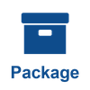 | `SsisPackage` | component | — | Package SSIS |
|  | `SsrsReport` | component | — | Rapport SSRS |

### Identité (`identity`)

Profil `org.mathouic.modelia.architecture.profile.identity.applicative.V01_00_000`

| Icône | Stéréotype | Cible | Méta-informations | Description |
|:---:|---|---|---|---|
|  | `AppRegistration` | component | `applicationId` : string | Inscription d'application Entra ID |
|  | `EnterpriseApplication` | component | `applicationId` : string | Application d'entreprise Entra ID |
|  | `OidcClient` | component | `clientId` : string<br>`protocol` : string | Client OpenID Connect ou SAML d'un royaume |
|  | `Realm` | component | — | Royaume Keycloak |
|  | `RelyingParty` | component | `identifier` : string | Partie de confiance ADFS |

### Azure PaaS (`azure`)

Profil `org.mathouic.modelia.architecture.profile.azure.applicative.V01_00_000`

| Icône | Stéréotype | Cible | Méta-informations | Description |
|:---:|---|---|---|---|
|  | `Certificate` | component | `expirationDate` : date | Certificat d'un Key Vault |
|  | `Function` | component | `trigger` : string | Fonction d'une Function App |
| 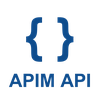 | `ManagedApi` | component | `path` : string<br>`version` : string | API publiée dans API Management |
|  | `Secret` | component | — | Secret d'un Key Vault |
|  | `Workflow` | component | — | Workflow d'une Logic App |

### Messagerie (`messaging`)

Profil `org.mathouic.modelia.architecture.profile.messaging.applicative.V01_00_000`

| Icône | Stéréotype | Cible | Méta-informations | Description |
|:---:|---|---|---|---|
|  | `Exchange` | component | `exchangeType` : string | Exchange RabbitMQ |
| 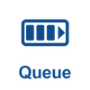 | `Queue` | component | — | File de messages |
|  | `Subscription` | component | — | Abonnement à un topic |
|  | `Topic` | component | — | Topic de publication |

### Observabilité (`observability`)

Profil `org.mathouic.modelia.architecture.profile.observability.applicative.V01_00_000`

| Icône | Stéréotype | Cible | Méta-informations | Description |
|:---:|---|---|---|---|
|  | `Dashboard` | component | — | Tableau de bord |

### Poste client (`client`)

Profil `org.mathouic.modelia.architecture.profile.client.applicative.V01_00_000`

| Icône | Stéréotype | Cible | Méta-informations | Description |
|:---:|---|---|---|---|
|  | `MobileApp` | component | `version` : string | Application mobile |
|  | `OfficeAddin` | component | `version` : string | Complément Office |
|  | `SinglePageApplication` | component | `version` : string | Application monopage (SPA) |
|  | `TeamsApp` | component | `version` : string | Application Teams |

### Transverse

Profil `org.mathouic.modelia.architecture.profile.applicative.V01_00_000`

Aucun stéréotype pour l'instant.

## Contextes applicatifs

Référentiel `architectureProfile.applicativeContext/`. Les serveurs logiciels sur lesquels s'exécutent les composants applicatifs.

### Exécution (`runtime`)

Profil `org.mathouic.modelia.architecture.profile.runtime.applicationcontext.V01_00_000`

| Icône | Stéréotype | Cible | Méta-informations | Description |
|:---:|---|---|---|---|
|  | `DotNet` | component | `version` : string | Runtime .NET (Core / 5+) |
|  | `DotNetFramework` | component | `version` : string | Runtime .NET Framework 4.x |
|  | `IIS` | component | `version` : string | Serveur web IIS |
|  | `IISSite` | component | `bindings` : string*<br>`appPool` : string | Site IIS, avec ses liaisons et son pool d'applications |
| 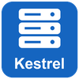 | `Kestrel` | component | `version` : string | Serveur web Kestrel d'ASP.NET Core |
|  | `NodeJs` | component | `version` : string | Runtime Node.js |
|  | `WindowsService` | component | `serviceName` : string<br>`account` : string | Service Windows |

### Données (`data`)

Profil `org.mathouic.modelia.architecture.profile.data.applicationcontext.V01_00_000`

| Icône | Stéréotype | Cible | Méta-informations | Description |
|:---:|---|---|---|---|
| 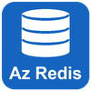 | `AzureCacheForRedis` | component | `serviceTier` : string | Azure Cache for Redis |
| 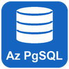 | `AzurePostgreSqlServer` | component | `version` : string<br>`serviceTier` : string | Azure Database for PostgreSQL |
|  | `AzureSqlManagedInstance` | component | `serviceTier` : string | Azure SQL Managed Instance |
| 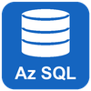 | `AzureSqlServer` | component | — | Serveur logique Azure SQL Database |
|  | `AzureStorageAccount` | component | `kind` : string<br>`replication` : string | Compte de stockage Azure |
|  | `PostgreSqlServer` | component | `version` : string | Serveur PostgreSQL |
| 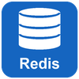 | `Redis` | component | `version` : string | Serveur Redis |
|  | `SSIS` | component | `version` : string | SQL Server Integration Services |
|  | `SSRS` | component | `version` : string | SQL Server Reporting Services |
|  | `SqlServerInstance` | component | `version` : string<br>`edition` : string<br>`instanceName` : string | Instance MS SQL Server |

### Identité (`identity`)

Profil `org.mathouic.modelia.architecture.profile.identity.applicationcontext.V01_00_000`

| Icône | Stéréotype | Cible | Méta-informations | Description |
|:---:|---|---|---|---|
|  | `ActiveDirectoryDomain` | component | `domainName` : string | Domaine Active Directory |
|  | `Adfs` | component | `version` : string | Active Directory Federation Services |
|  | `EntraIdTenant` | component | `tenantId` : string | Tenant Microsoft Entra ID |
|  | `KeycloakServer` | component | `version` : string | Serveur Keycloak |

### Azure PaaS (`azure`)

Profil `org.mathouic.modelia.architecture.profile.azure.applicationcontext.V01_00_000`

| Icône | Stéréotype | Cible | Méta-informations | Description |
|:---:|---|---|---|---|
|  | `ApiManagement` | component | `serviceTier` : string | Azure API Management |
|  | `AppConfiguration` | component | — | Azure App Configuration |
|  | `AppService` | component | `runtimeStack` : string | Azure App Service |
|  | `FunctionApp` | component | `runtimeStack` : string | Azure Function App |
|  | `KeyVault` | component | — | Azure Key Vault |
|  | `LogicApp` | component | `plan` : string | Azure Logic App |

### Messagerie (`messaging`)

Profil `org.mathouic.modelia.architecture.profile.messaging.applicationcontext.V01_00_000`

| Icône | Stéréotype | Cible | Méta-informations | Description |
|:---:|---|---|---|---|
|  | `AzureEventGrid` | component | — | Azure Event Grid |
|  | `AzureServiceBus` | component | `serviceTier` : string | Namespace Azure Service Bus |
|  | `Kafka` | component | `version` : string | Cluster Kafka |
|  | `RabbitMq` | component | `version` : string | Serveur RabbitMQ |

### Observabilité (`observability`)

Profil `org.mathouic.modelia.architecture.profile.observability.applicationcontext.V01_00_000`

| Icône | Stéréotype | Cible | Méta-informations | Description |
|:---:|---|---|---|---|
| 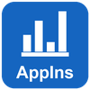 | `ApplicationInsights` | component | — | Azure Application Insights |
|  | `Elasticsearch` | component | `version` : string | Cluster Elasticsearch |
|  | `Grafana` | component | `version` : string | Serveur Grafana |
|  | `LogAnalyticsWorkspace` | component | `retentionDays` : number | Espace de travail Log Analytics |
|  | `Seq` | component | `version` : string | Serveur de logs Seq |

### Poste client (`client`)

Profil `org.mathouic.modelia.architecture.profile.client.applicationcontext.V01_00_000`

| Icône | Stéréotype | Cible | Méta-informations | Description |
|:---:|---|---|---|---|
|  | `MobileOS` | component | `platform` : string | Système d'exploitation mobile |
|  | `OfficeHost` | component | `applications` : string* | Application Office hôte (Outlook, Excel…) |
|  | `Teams` | component | — | Microsoft Teams |
|  | `WebBrowser` | component | `supportedBrowsers` : string* | Navigateur web |

## Composants systèmes

Référentiel `architectureProfile.system/`. Les éléments d'infrastructure sur lesquels s'exécutent les contextes applicatifs, ou qui assurent leur communication.

Profil `org.mathouic.modelia.architecture.profile.system.V01_00_000`. Ce profil n'est pas découpé en familles ; ses stéréotypes sont regroupés ici par thème.

### Hébergement

| Icône | Stéréotype | Cible | Méta-informations | Description |
|:---:|---|---|---|---|
|  | `VirtualMachine` | component | `os` : string<br>`osVersion` : string<br>`size` : string | Machine virtuelle |
|  | `PhysicalServer` | component | `os` : string<br>`osVersion` : string | Serveur physique |
| 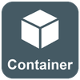 | `Container` | component | `image` : string | Conteneur |
| 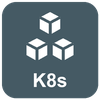 | `KubernetesCluster` | component | `version` : string | Cluster Kubernetes |
| 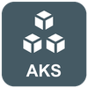 | `AzureKubernetesService` | component | `version` : string | Azure Kubernetes Service (AKS) |
| 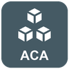 | `AzureContainerAppsEnvironment` | component | — | Environnement Azure Container Apps |
| 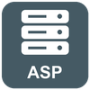 | `AppServicePlan` | component | `sku` : string | Plan App Service |

### Réseau

| Icône | Stéréotype | Cible | Méta-informations | Description |
|:---:|---|---|---|---|
|  | `VirtualNetwork` | component | `addressSpace` : string* | Réseau virtuel |
| 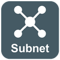 | `Subnet` | component | `addressPrefix` : string | Sous-réseau |
| 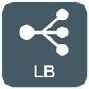 | `LoadBalancer` | component | — | Répartiteur de charge |
|  | `ApplicationGateway` | component | `waf` : string | Azure Application Gateway (WAF) |
|  | `AzureFrontDoor` | component | — | Azure Front Door |
|  | `Firewall` | component | — | Pare-feu |
|  | `ReverseProxy` | component | `product` : string | Reverse proxy |
|  | `DnsZone` | component | `zoneName` : string | Zone DNS |

### Organisation Azure

| Icône | Stéréotype | Cible | Méta-informations | Description |
|:---:|---|---|---|---|
|  | `AzureSubscription` | folder | `subscriptionId` : string | Abonnement Azure |
|  | `AzureResourceGroup` | folder | `region` : string | Groupe de ressources Azure |
